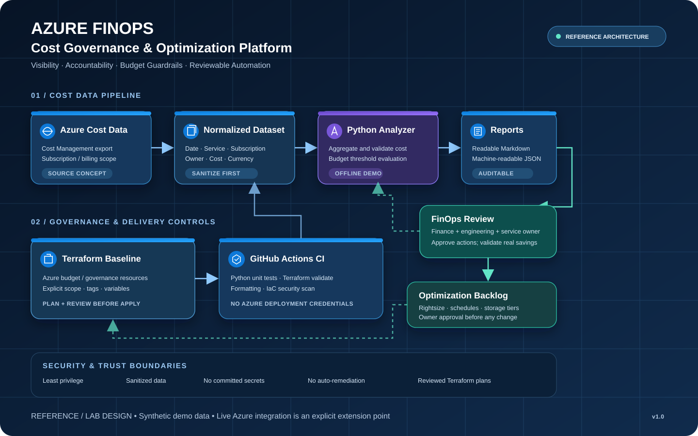

<!--
  AZURE FINOPS | COST GOVERNANCE PLATFORM
  Portfolio project: Terraform + Python + GitHub Actions
-->

<div align="center">

# ☁️ Azure FinOps & Cost Governance Platform

### From cloud spend visibility to actionable cost governance.

<p>
  
  
  
  
</p>

**An enterprise-style reference implementation for cloud financial management (FinOps), cost visibility, budget guardrails, and optimization workflows on Microsoft Azure.**

[Architecture](docs/architecture.md) · [Quick Start](#-quick-start) · [Demo Report](reports/sample-cost-report.md) · [Security](#-security--safe-usage)

</div>

---

## Executive overview

Cloud costs become difficult to govern when teams cannot consistently answer four questions: **what are we spending, who owns it, what is changing, and what action should happen next?** This project demonstrates a repeatable FinOps workflow that combines infrastructure-as-code foundations, cost-data analysis, budget guardrails, and automated quality checks.

> **Portfolio / lab status:** This repository is a reference implementation. The included sample data is synthetic. No live Azure billing data is queried and no Azure resources are deployed by the CI workflow. Configure and validate the Azure-specific deployment steps in your own subscription before production use.

## Architecture



*The diagram separates Azure cost-data sources and governance controls from the analytics/reporting pipeline. The included Python analyzer works offline against a sample export; a live Cost Management API integration is an extension point, not something silently assumed to be configured.*

**Architecture source:** [Open the SVG diagram](docs/architecture.svg) · [Architecture notes](docs/architecture.md)

## What this project demonstrates

| Capability | What it shows |
|---|---|
| **Cost visibility** | Normalize a cost-export-style JSON dataset and summarize spend by subscription, service, and owner |
| **Budget guardrails** | Compare actual spend with a configurable threshold and emit a clear warning status |
| **Optimization signals** | Surface sample-based opportunities for review without claiming automatic savings |
| **Governance metadata** | Encourage consistent ownership, environment, application, and cost-centre tags |
| **Infrastructure as Code** | Terraform baseline for Azure governance resources, maintained separately from analysis code |
| **CI quality gates** | Format/validation checks, Python tests, and infrastructure security scanning |
| **Auditability** | Produce deterministic Markdown/JSON reports suitable for pull requests and review |

## Repository map

```text
azure-finops-cost-governance/
├── .github/workflows/ci.yml        # PR checks: Python tests + Terraform checks
├── docs/
│   ├── architecture.md             # Design decisions and data flow
│   └── architecture.svg            # Portfolio-ready architecture diagram
├── examples/
│   └── cost-data.sample.json       # Synthetic cost records for safe local testing
├── infra/
│   └── terraform/
│       ├── versions.tf             # Provider and Terraform constraints
│       ├── main.tf                 # Budget / governance baseline
│       ├── variables.tf            # Explicit configuration
│       ├── outputs.tf              # Non-sensitive outputs
│       └── terraform.tfvars.example
├── reports/
│   └── sample-cost-report.md       # Example output using synthetic data
├── scripts/
│   └── finops_analyzer.py          # Offline cost analysis and report generation
├── tests/
│   └── test_finops_analyzer.py     # Unit tests
├── .gitignore
├── LICENSE
└── README.md
```

## 🚀 Quick start

### 1. Run the offline cost analyzer

Requirements: Python 3.10+; no third-party packages required.

```bash
python scripts/finops_analyzer.py \
  --input examples/cost-data.sample.json \
  --budget 1000 \
  --threshold 80 \
  --markdown-out reports/generated-cost-report.md \
  --json-out reports/generated-cost-report.json
```

The sample currency is **USD** and the values are synthetic. Replace the example dataset with a properly exported and normalized cost file before using results for decisions.

### 2. Run tests

```bash
python -m unittest discover -s tests -v
```

### 3. Review the Terraform baseline

```bash
cd infra/terraform
cp terraform.tfvars.example terraform.tfvars
terraform fmt -recursive
terraform init -backend=false
terraform validate
terraform plan
```

The Azure provider may require authenticated access for a real plan depending on provider configuration. Review every plan and the applicable Azure scope before applying anything. Do **not** commit real `terraform.tfvars`, credentials, state, or exported billing data.

## 🧭 FinOps operating workflow

1. **Inform:** bring cost data into a consistent schema and make spend visible by service, subscription, and owner.
2. **Optimize:** inspect trends and candidates; validate each action with service owners and performance requirements.
3. **Operate:** define budgets, thresholds, ownership tags, and review cadences.
4. **Govern:** use code review and automated checks to make infrastructure and policy changes traceable.
5. **Improve:** compare actual outcomes over time; savings are measured only after validating a baseline and the post-change bill.

## Security & safe usage

- No secrets, credentials, or real cost exports belong in this repository.
- The GitHub Actions workflow is **validation-only**. It does not authenticate to Azure or run `terraform apply`.
- Budget notifications and actual Azure Cost Management data retrieval need subscription-specific configuration, permissions, and validation.
- The analyzer flags budget threshold status only from the data supplied to it. It does not send alerts or change Azure resources.
- Treat optimization suggestions as review candidates, not guaranteed savings.
- Pin and review action/provider versions before production adoption. Apply organization-approved supply-chain controls where required.

## Roadmap

- [x] Offline cost analyzer with deterministic reports
- [x] Synthetic sample dataset and unit tests
- [x] Architecture diagram and design notes
- [x] CI checks for Python and Terraform
- [ ] Add Azure Cost Management export ingestion adapter
- [ ] Add subscription-scoped budget alert configuration
- [ ] Add Azure Policy initiatives for required ownership/cost tags
- [ ] Publish a dashboard fed by approved, sanitized cost data

## Interview discussion points

- How would you allocate shared platform costs across product teams?
- What is the difference between budgets, alerts, forecasts, and anomaly detection?
- How would you secure a Cost Management API integration using least privilege?
- Why should cost optimization be balanced against reliability and performance?
- How would you prevent Terraform from accidentally deploying into the wrong subscription?
- Which metrics prove a real saving rather than a temporary billing fluctuation?

## Author

Built as a practical cloud engineering portfolio project demonstrating Azure governance, Terraform, Python automation, CI quality gates, and FinOps principles.

If this architecture is useful, explore the design and sample workflow, raise an issue with suggestions, or fork it for a lab environment.

---

<div align="center">

**Make cloud cost visible. Make ownership explicit. Make every optimization reviewable.**

</div>
