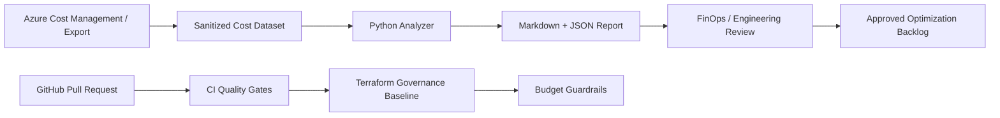

# Architecture — Azure FinOps & Cost Governance

## Design goal

Provide a reviewable workflow for cloud cost visibility and guardrails without mixing cost analysis with infrastructure deployment. The repository is deliberately split into an offline demo path and an Azure deployment foundation.

## Components

1. **Azure Cost Management / export (source concept):** an organization can export subscription or billing-scope data in an approved format. This repository does not claim to retrieve live data.
2. **Sanitized cost dataset:** normalize records into `date`, `subscription`, `service`, `owner`, and `cost`. Do not commit real billing data.
3. **Python analyzer:** validates input, aggregates spend, compares spend against a supplied budget threshold, and writes Markdown/JSON reports.
4. **Governance baseline (Terraform):** demonstrates subscription/resource-group level budget guardrails. Verify scope, provider version, and notification recipients before deployment.
5. **GitHub Actions:** runs unit tests, formatting/validation checks, and an infrastructure scanner on pull requests. It has no Azure credentials and never applies infrastructure.
6. **FinOps review:** engineering, finance, and service owners assess anomalies and savings candidates before any change is approved.

## Data flow

## Trust boundaries

- Billing exports may contain commercially sensitive information. Use synthetic samples for public demos and restrict production data to approved storage.
- GitHub Actions runs without Azure credentials by default.
- A production Cost Management API integration should use a least-privileged identity, managed identity where hosted in Azure, or OIDC federation from GitHub Actions where supported. Avoid long-lived client secrets.
- Terraform state may reveal sensitive infrastructure metadata. Use a secured remote backend with appropriate access, locking, and encryption for shared environments.

## Non-goals in this iteration

- No live bill retrieval.
- No automatic resource deletion or rightsizing.
- No alert delivery to email/chat.
- No claim of realized savings.
- No production readiness certification.

These are explicit extension points; they should be implemented and tested in an isolated Azure subscription before operational use.
